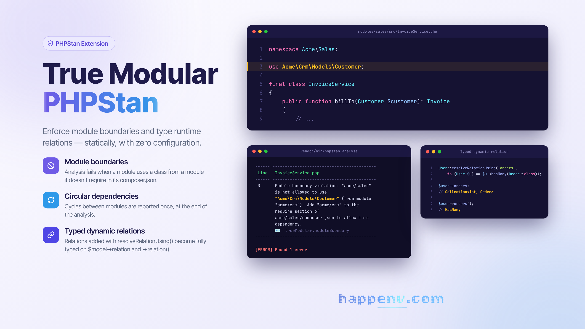

# PHPStan for Laravel True Modular

<div class="filament-hidden">



</div>

[](https://packagist.org/packages/happenv-com/laravel-true-modular-phpstan)
[](https://packagist.org/packages/happenv-com/laravel-true-modular-phpstan)
[](https://github.com/happenv-com/laravel-true-modular-phpstan/actions/workflows/tests.yml)
[](https://github.com/happenv-com/laravel-true-modular-phpstan/actions/workflows/phpstan.yml)
[](https://github.com/happenv-com/laravel-true-modular-phpstan/actions/workflows/zizmor.yml)
[](https://github.com/happenv-com/laravel-true-modular-phpstan/actions/workflows/fix-code-style.yml)

PHPStan extensions for [laravel-true-modular](https://github.com/happenv-com/laravel-true-modular)
modular monoliths. Ships three independent, **zero-config** extensions — the first two
are on by default, the third is opt-in:

| Extension | What it does |
| --- | --- |
| **Dynamic Relation Resolver** | Teaches PHPStan about Eloquent relations registered at runtime via `Model::resolveRelationUsing()` (e.g. relations one module adds to another module's model). Such relations are normally invisible to static analysis — this extension makes `$model->relation` and `$model->relation()` fully typed. |
| **Module Boundary Enforcer** | Fails analysis when a module references a class from another module that is **not** declared in its `composer.json` `require`. Also detects circular dependencies between modules. |
| **Model Extension Attribute Resolver** (opt-in) | Teaches PHPStan about the `get<X>Attribute()` accessors a module's model extension adds to another module's model, so `$model->x` is typed from the accessor instead of being an undefined property. |

Requires PHP 8.3+, PHPStan 2.x and `laravel-true-modular` (Laravel 12/13). It reuses
the framework's own module discovery, so it understands your modules out of the box —
no PHPStan parameters to set.

## Installation

```bash
composer require --dev happenv-com/laravel-true-modular-phpstan
```

The package is a `phpstan-extension`. If you use
[`phpstan/extension-installer`](https://github.com/phpstan/phpstan-extension-installer)
(recommended), the two default extensions are registered automatically — nothing else
to do:

```bash
composer require --dev phpstan/extension-installer
```

Make sure the plugin is allowed in your root `composer.json`:

```json
{
    "config": {
        "allow-plugins": {
            "phpstan/extension-installer": true
        }
    }
}
```

### Manual registration (without extension-installer)

Include the bundled config in your `phpstan.neon`:

```neon
includes:
    - vendor/happenv-com/laravel-true-modular-phpstan/extension.neon
```

Or cherry-pick a single extension:

```neon
includes:
    - vendor/happenv-com/laravel-true-modular-phpstan/rules/dynamic-relations.neon
    - vendor/happenv-com/laravel-true-modular-phpstan/rules/module-boundary.neon
```

The [Model Extension Attribute Resolver](#model-extension-attribute-resolver-opt-in) is
never registered automatically; include `rules/model-extension-attributes.neon` to turn
it on.

> **Larastan recommended.** The Dynamic Relation Resolver reflects your Eloquent
> models, so install [`larastan/larastan`](https://github.com/larastan/larastan)
> for accurate results. With `extension-installer` it is wired up automatically.

## Zero configuration

None of the extensions needs any `parameters` in `phpstan.neon`. The Module Boundary
Enforcer discovers modules through `laravel-true-modular`'s own `ModuleRegistry`,
which means it automatically honours:

- the configured module composer type (`Application::moduleComposerType()`, default
  `true-module`), and
- the configured modules directory (`Application::modulesDirectory()`, default
  `app-modules`).

A "module" is any package under that directory whose `composer.json` declares the
module type. Allowed cross-module dependencies are read straight from each module's
`composer.json` `require` section — exactly the same source of truth the framework
uses to order service providers at runtime. There is no vendor prefix or path to
configure.

> If no modules are found (e.g. the directory does not exist), both rules silently
> do nothing, so installing the package never breaks an unrelated build.

## What it reports

### Dynamic Relation Resolver

Once installed it automatically types any relation registered through Laravel's
relation resolver, for example:

```php
// In some module's service provider initialize()/boot():
User::resolveRelationUsing('orders', fn (User $user) => $user->hasMany(Order::class));
```

```php
$user->orders;   // PHPStan now sees: Illuminate\Database\Eloquent\Collection<int, Order>
$user->orders(); // PHPStan now sees: Illuminate\Database\Eloquent\Relations\HasMany
```

To-one relations (`hasOne`, `belongsTo`, `morphOne`, `hasOneThrough`) are typed as
`Related|null`; to-many relations as `Collection<int, Related>`.

### Model Extension Attribute Resolver (opt-in)

A model extension adds accessors to another module's model, which laravel-true-modular
serves at runtime through Eloquent's missing-attribute hook. PHPStan cannot see them, so
`$task->remaining_hours` is an undefined property. Include the resolver to fix that:

```neon
includes:
    - vendor/happenv-com/laravel-true-modular-phpstan/rules/model-extension-attributes.neon
```

```php
// In the scheduling module's provider:
public function configureModule(Module $module): void
{
    $module->hasModelExtensions(Task::class, TaskSchedulingExtension::class);
}

final class TaskSchedulingExtension extends ModelExtension
{
    public function getRemainingHoursAttribute(): int { /* ... */ }

    /** @return int<0, max> */
    public function getElapsedHoursAttribute(): int { /* ... */ }
}
```

```php
$task->remaining_hours;   // PHPStan now sees: int
$task->elapsed_hours;     // PHPStan now sees: int<0, max> (the accessor's PHPDoc is honoured)
```

- **Source of truth.** The extensions come from laravel-true-modular's
  `ModuleManifestRepository`, i.e. what the modules declared with `hasModelExtensions()`
  while the application booted. Like the Dynamic Relation Resolver, it therefore needs
  the application to boot during analysis (Larastan). Without a booted application the
  registry is empty and the resolver claims nothing.
- **What counts as an attribute.** Every public `get<X>Attribute()` method declared on
  the extension class itself becomes the `snake_case` attribute `x`, typed from the
  method's return type (PHPDoc included). Protected/private methods, methods inherited
  from a parent class and public methods that are not accessors are ignored. Accessors
  from several modules extending the same model are all collected.
- **Same attribute from two modules.** If two extensions of one model provide the same
  attribute, it is typed from the one laravel-true-modular answers with at runtime: the
  extension registered first, i.e. in the order the module providers are initialised
  (dependency order). That order is read from the booted application's
  `AttributeResolversBag`; without it, the first declared extension wins.
- **Relations are left alone.** Relation methods on a model extension are the Dynamic
  Relation Resolver's job; this resolver never claims them, so an extension that only
  adds relations contributes nothing here and the two never declare the same property.
- **Writable.** Unlike a relation property, the attribute can be assigned
  (`$task->remaining_hours = 3`), because Eloquent's attribute bag accepts it.

**Why it is opt-in.** PHPStan consults property extensions *before* `@property` tags. On
a model that already documents a contributed attribute (`@property string $total_due`),
the resolver takes over and types it from the accessor instead (`float`). That is usually
the more accurate answer, and a `@property-read` attribute becomes writable, but either
can change what existing code is checked against — not only remove "undefined property"
errors — so it is a decision to make, not something an upgrade does to you.

### Module Boundary Enforcer

For every module the enforcer reads its `composer.json` and treats its `require`
entries that resolve to **other known modules** as the allowed cross-module
dependencies. A module may always reference its own classes and any class from a
package that is not a module (vendor libraries, the host application, …).

Violations look like:

```
Module boundary violation: "acme/sales" is not allowed to use "Acme\Crm\Models\Customer"
(from module "acme/crm"). Add "acme/crm" to the require section of acme/sales/composer.json
to allow this dependency.
```

Both `use` statements and inline references (`new`, static calls, `instanceof`,
`extends`/`implements`, `catch`, class constants) are checked.

Circular dependencies are reported once at the end of analysis:

```
Circular dependency detected between modules: acme/sales → acme/crm → acme/sales. ...
```

The module manifests are declared to PHPStan's result cache (PHPStan 2.3+), so editing
a module's `composer.json` — even without touching `composer.lock` or any PHP file —
re-runs these rules instead of replaying errors computed from the old dependency graph.
This works when the rules come from the bundled `rules/*.neon` files; a rule registered
by hand without its `manifests` argument still works, but is not re-run on such an edit.

#### Error identifiers

You can ignore findings by identifier in `phpstan.neon`:

| Identifier | Meaning |
| --- | --- |
| `trueModular.moduleBoundary` | Disallowed cross-module reference |
| `trueModular.circularDependency` | Cycle between modules |

```neon
parameters:
    ignoreErrors:
        - identifier: trueModular.moduleBoundary
          path: app-modules/legacy/*
```

## Example `phpstan.neon`

```neon
includes:
    # auto-included by extension-installer; shown here for the manual case
    - vendor/happenv-com/laravel-true-modular-phpstan/extension.neon

parameters:
    level: 6
    paths:
        - app-modules
```

That's the whole configuration — point PHPStan at your modules and run it.

## AI assistants (Laravel Boost)

The package ships a [Laravel Boost](https://laravel.com/docs/boost) skill, `true-modular-phpstan-development`, in `resources/boost/skills/`. `php artisan boost:install` (or `boost:update`) offers it to your coding agent: what each `trueModular.*` finding means and how to fix it without moving the problem, the opt-in `require-dev` cycle checks, what the relation resolver needs to see a model extension, and the opt-in attribute resolver for its accessors.

## Development

```bash
composer install
vendor/bin/pest        # test suite (Pest 4)
vendor/bin/pint        # code style
```

The test suite covers every extension:

- **Dynamic relations** — boots an in-memory Eloquent connection, registers
  relations via `Model::resolveRelationUsing()`, and asserts the resolver exposes
  them with the correct method/property types.
- **Model extension attributes** — builds fixture modules whose model extensions add
  accessors and relations to each other's models, and asserts the attribute map, the
  property types (also through `assertType()` fixtures) and that the undefined-property
  errors disappear only with the opt-in configuration.
- **Module boundary** — uses PHPStan's `RuleTestCase` against fixture modules under
  `tests/Fixtures` to assert allowed/disallowed cross-module references and circular
  dependency detection.

## License

[MIT](LICENSE.md)
